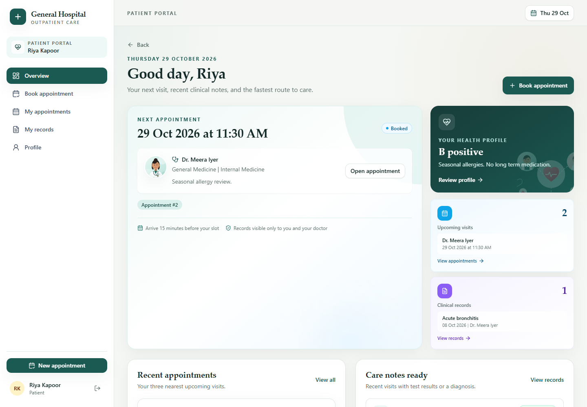
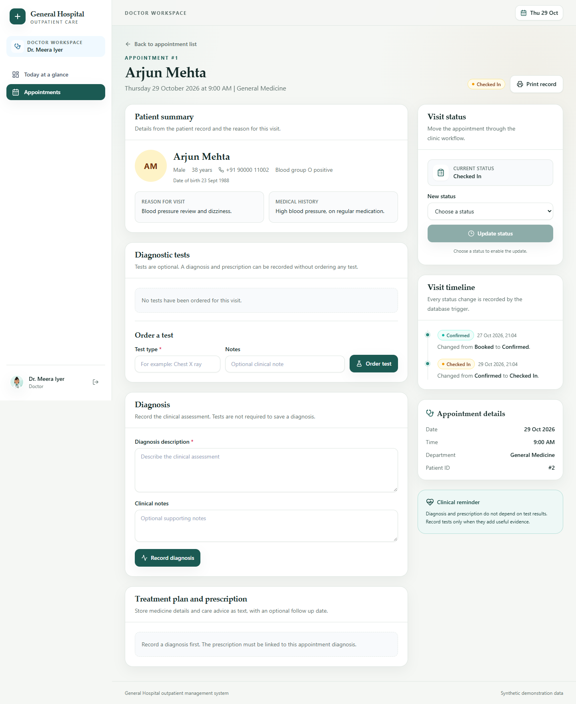
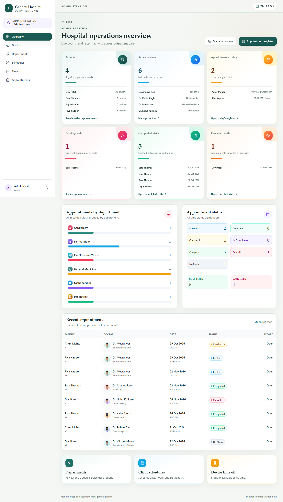

# Project Report

## General Hospital Outpatient Management System

Submitted as an undergraduate Database Management Systems mini project.

Date: 29 October 2026

## 1. Abstract

The General Hospital Outpatient Management System is a web application for managing the outpatient journey from appointment booking to consultation records. Patients can compare departments and doctors, view open appointment slots, book a slot, cancel an eligible appointment, review their own clinical history, and print records. Doctors can see only their assigned appointments, move visits through a controlled status sequence, order optional diagnostic tests, record test results, write a diagnosis and prescription, and set a follow up date. Administrators manage departments, doctor accounts, clinic schedules, time off, and the full appointment list.

The project was built to demonstrate practical database concepts rather than to imitate a full hospital enterprise product. The database contains twelve related tables with primary keys, foreign keys, unique constraints, check constraints, indexes, a generated column, a trigger, and a stored procedure. Appointment booking runs inside a transaction and uses row locking plus a unique active slot constraint to prevent double booking. The application uses MySQL 8, a Flask API, and a React frontend.

## 2. Problem statement

A small outpatient department needs a simple way to answer five questions:

1. Which doctors are available, and when?
2. Which appointment slots are still open?
3. Which patients are expected today?
4. What happened during each consultation?
5. Who is allowed to see or change each record?

Paper registers and disconnected spreadsheets make these questions hard to answer. They also allow the same slot to be written down twice and make it difficult to enforce who may view a patient record.

This project addresses those problems with a normalised relational database and a role based web interface.

## 3. Objectives

* Model patients, departments, doctors, schedules, appointments, tests, diagnoses, prescriptions, and audit history in MySQL.
* Prevent two active appointments from claiming the same doctor, date, and time.
* Provide a clear booking workflow with server side availability checks.
* Keep diagnostic tests optional while still allowing a diagnosis and prescription.
* Enforce patient, doctor, and administrator permissions in the backend.
* Store passwords as secure hashes, never as plain text.
* Provide dashboards and print views that a student can explain in a viva.
* Use synthetic data only.

## 4. Scope

### Included

* Public department and doctor directory with search.
* Doctor profile with clinic hours and live availability.
* Patient registration, sign in, and sign out.
* Patient appointment booking and cancellation.
* Patient appointment list, detail view, clinical records, and profile editing.
* Doctor dashboard, appointment list, status updates, test orders, test results, diagnosis, and prescription.
* Administrator dashboard and management of departments, doctors, schedules, time off, and appointments.
* Print views for appointment confirmation, clinical record, test report, and visit history.
* Responsive layout, loading states, empty states, validation messages, success messages, and failure messages.

### Not included

* Inpatient admission, beds, wards, or surgery management.
* Pharmacy inventory or medicine stock.
* Billing, insurance, or payment processing.
* Laboratory device integration or uploaded reports.
* Email, SMS, or push notifications.
* Multi hospital tenancy.
* Real patient data.

## 5. Users and permissions

| Action | Patient | Doctor | Administrator |
| --- | --- | --- | --- |
| Browse public doctors and departments | Yes | Yes | Yes |
| View own profile | Yes | No | No |
| Edit own patient profile | Yes | No | No |
| Book an appointment | Yes | No | No |
| Cancel an appointment | Own eligible appointment | No | Any eligible appointment |
| View appointment list | Own only | Assigned only | All |
| View clinical record | Own only | Assigned only | No clinical write access |
| Change appointment status | No | Assigned appointment, allowed transitions only | No |
| Order tests and record results | No | Assigned appointment | No |
| Record diagnosis and prescription | No | Assigned appointment | No |
| Manage departments and doctors | No | No | Yes |
| Manage schedules and time off | No | No | Yes |
| Reset a doctor password | No | No | Yes |

The backend checks the signed in account and its role on every protected route. Frontend route guards improve the experience but are not the security boundary.

## 6. Technology stack

| Layer | Choice | Reason |
| --- | --- | --- |
| Database | MySQL 8, InnoDB, utf8mb4 | Supports transactions, row locks, generated columns, triggers, stored procedures, and strong constraints |
| Backend | Python and Flask | Small, readable API with clear blueprints |
| ORM | Flask SQLAlchemy | Parameterised queries and readable relationships |
| Migrations | Flask Migrate and Alembic | Repeatable schema creation |
| Authentication | Flask session cookie and Werkzeug password hashing | Simple session model suitable for a mini project |
| Frontend | React 18 and TypeScript | Component based interface with type safety |
| Build tool | Vite | Fast development server and production build |
| Styling | Tailwind CSS | Consistent spacing, colour, and responsive layout |
| Icons | Lucide React | Clear visual labels |
| Backend tests | Pytest | API, permission, constraint, and concurrency checks |
| Frontend tests | Vitest and React Testing Library | Component and hook behaviour |

## 7. System architecture

```text
Browser
  |
  | HTTP and JSON
  v
React application on port 5173
  |
  | /api proxy
  v
Flask API on port 5000
  |
  | SQLAlchemy and PyMySQL
  v
MySQL 8 on port 3307 in this workspace
```

The frontend is a single page application. The Vite development server proxies `/api` requests to Flask, so the browser uses one origin during development. The Flask API keeps a signed session cookie and returns JSON. The database is the only shared source of truth.

### Backend structure

| Module | Responsibility |
| --- | --- |
| `app/__init__.py` | Application factory, blueprint registration, JSON settings, CORS |
| `app/config.py` | Environment configuration and session settings |
| `app/models.py` | Twelve SQLAlchemy models and their constraints |
| `app/auth.py` | Registration, login, logout, current user, role decorators |
| `app/public.py` | Public department, doctor, and availability endpoints |
| `app/appointments.py` | Patient profile, appointments, records, booking, cancellation |
| `app/doctor.py` | Doctor summaries, status changes, tests, diagnosis, prescription |
| `app/admin.py` | Administrator summaries and management endpoints |
| `app/services/availability.py` | Slot generation, time zone handling, status rules, cancellation rules |
| `app/services/booking.py` | Stored procedure call and error translation |
| `app/serializers.py` | Stable JSON shapes |
| `app/validation.py` | Field parsing and validation helpers |
| `app/errors.py` | Safe JSON error responses |
| `app/db_objects.py` | Trigger and stored procedure SQL |
| `app/seed.py` | Synthetic demonstration data |
| `app/cli.py` | Database check, seed, and reset commands |

### Frontend structure

| Area | Responsibility |
| --- | --- |
| `src/App.tsx` | Route map for public, patient, doctor, admin, and print pages |
| `src/auth/AuthContext.tsx` | Session state, sign in, sign out, role home |
| `src/api/client.ts` | JSON request helper and typed API errors |
| `src/hooks/useApi.ts` | Loading, error, data, and reload behaviour |
| `src/components/` | Buttons, cards, forms, modal, pagination, badges, timeline, record display, avatars, statistics |
| `src/pages/` | Public, patient, doctor, admin, and print screens |
| `src/utils/` | Formatting and visual mapping helpers |

## 8. Database design

The database has twelve tables.

| Table | Purpose |
| --- | --- |
| `patient` | Patient demographic and medical summary |
| `department` | Clinical department |
| `doctor` | Doctor profile and department link |
| `user_account` | Sign in identity, password hash, role, and optional patient or doctor link |
| `doctor_schedule` | Weekly clinic hours and slot duration |
| `doctor_time_off` | Blocked periods |
| `appointment` | Booking, status, reason, and timestamps |
| `test_order` | Optional diagnostic test ordered during a visit |
| `test_result` | Result for one test order |
| `diagnosis` | One diagnosis for an appointment |
| `prescription` | Treatment plan and instructions for one diagnosis |
| `appointment_status_history` | Audit rows written by the trigger |

### Key relationships

* One department has many doctors.
* One patient has zero or one account. One doctor has zero or one account.
* One doctor has many schedules, time off entries, and appointments.
* One patient has many appointments.
* One appointment has many test orders, zero or one diagnosis, and many status history rows.
* One test order has zero or one result.
* One diagnosis has zero or one prescription.

### Important constraints

* `department_name` is unique.
* `user_account.username` is unique.
* A role link check ensures a patient account points to a patient, a doctor account points to a doctor, and an administrator points to neither.
* Appointment status is restricted to `Booked`, `Confirmed`, `Checked In`, `In Consultation`, `Completed`, `Cancelled`, and `No Show`.
* A generated column `slot_active` is 1 for active statuses and `NULL` for cancelled or no show rows.
* A unique constraint on doctor, date, time, and `slot_active` allows a cancelled slot to be booked again while blocking a second active booking.
* `test_result.test_id`, `diagnosis.appointment_id`, and `prescription.diagnosis_id` are unique, enforcing one result, one diagnosis, and one prescription per parent record.
* Check constraints validate gender, blood group, schedule day, schedule time range, slot duration, time off range, test status, and role values.

The full explanation is in [Database_Explanation.md](Database_Explanation.md).

## 9. Main workflows

### 9.1 Registration and sign in

A visitor registers as a patient. The server validates the name, email, password, date of birth, gender, phone, address, blood group, and medical history. The password is hashed with PBKDF2 SHA256 and 600,000 iterations. The patient row and account row are inserted in one transaction. A session cookie is created after success.

Doctor and administrator accounts are not created through public registration. The administrator creates doctor accounts from the administrator dashboard. Additional administrator accounts are created with the controlled `flask create-admin` setup command, which hashes the password and creates an account with no patient or doctor link. The demonstration administrator account is created by the seed command.

### 9.2 Availability

Availability is calculated for one doctor and one date.

1. Convert the date to a weekday.
2. Find active schedule rows for that weekday.
3. Generate slots from the start time in steps of the slot duration.
4. Exclude slots that have already started or passed.
5. Exclude slots that overlap a time off entry.
6. Exclude slots that overlap an active appointment.
7. Return the remaining slots.

The public endpoint and the booking procedure both apply these rules. The procedure repeats the checks inside a transaction because the public result can become stale between display and submit.

### 9.3 Booking

The patient chooses a doctor, date, and slot and provides a reason for the visit. The API calls `sp_book_appointment`.

The procedure:

1. Starts a transaction.
2. Locks the doctor row with `SELECT ... FOR UPDATE`.
3. Rejects missing or inactive doctors.
4. Rejects past times.
5. Finds an active schedule row that contains the requested time and aligns with the slot grid.
6. Rejects time off overlap.
7. Rejects an active appointment overlap.
8. Inserts the appointment.
9. Returns the new identifier and a message.
10. Commits, or rolls back on any failure.

If two requests reach the procedure together, the doctor row lock serialises them. The second request sees the first booking and fails with a clear conflict message. The unique active slot constraint is a second line of defence.

### 9.4 Cancellation

A patient may cancel an appointment while it is in `Booked` or `Confirmed` status and at least two hours before it starts. An administrator may cancel an appointment in `Booked`, `Confirmed`, or `Checked In` status. Cancellation sets the status to `Cancelled`. The trigger writes a history row. The generated `slot_active` value becomes `NULL`, so the slot can be booked again.

### 9.5 Consultation

The doctor sees only appointments assigned to that doctor. The normal status path is:

```text
Booked -> Confirmed -> Checked In -> In Consultation -> Completed
```

A doctor may also mark an eligible visit as `No Show` or `Cancelled` where the rules allow it. Clinical records can be written when the appointment is `Checked In`, `In Consultation`, or `Completed`.

The doctor may:

* Order zero or more tests.
* Record one result per test.
* Record one diagnosis per appointment.
* Record one prescription per diagnosis.
* Leave the follow up date empty.
* Complete the visit without ordering any test.

A test result is stored as evidence. It does not create a diagnosis automatically. The doctor remains responsible for the diagnosis.

### 9.6 Printing

Print pages use a dedicated layout without application navigation. Supported prints are appointment confirmation, full clinical record, test report, and visit history. The pages use the same backend data and permissions as the screen views.

## 10. Security and privacy

* Passwords are hashed with Werkzeug PBKDF2 SHA256 and 600,000 iterations.
* Password hashes are never returned by the API.
* Session cookies are HTTP only and use `SameSite=Lax`.
* Session lifetime defaults to eight hours.
* The API checks the role on every protected route.
* Patients can read only their own appointments and records.
* Doctors can read only appointments assigned to them.
* Administrators cannot write clinical records.
* Input is validated for type, length, allowed values, dates, and relationships.
* Database access uses SQLAlchemy parameter binding, except the controlled procedure call.
* Error responses use safe messages and do not expose stack traces.
* Request bodies are limited to one megabyte.
* Secrets are loaded from environment variables.
* The `.env` file is ignored by Git.
* All demonstration data is synthetic.

## 11. User interface

The interface uses a calm clinical palette with teal as the primary colour and distinct colours for status and statistics. It includes synthetic doctor portraits, department illustrations, and health artwork stored locally as SVG files, so no external image service is required.

Key screens:

* Public home page with departments, featured doctors, and care information.
* Doctor directory and doctor detail page with clinic hours and live slots.
* Patient overview with next appointment, quick actions, recent visits, and live visit and record cards.
* Booking page with doctor, date, slot, and specialty aware visit reason.
* Patient records and appointment detail with clinical timeline.
* Doctor dashboard with today counts, live patient previews, and upcoming visits.
* Consultation workspace with status controls, tests, diagnosis, and prescription.
* Administrator dashboard with colour coded metrics, live patient and test previews, and links into the appointment register.
* Print layouts for confirmation, record, tests, and history.

The public home page, sign in page, registration page, and the three role landing pages do not show a back control. Subpages use the shared page header button on signed in pages, the public layout button on public subpages, or a contextual link back to their parent list. The print layout provides its own back button.

The booking form shows examples for the selected specialty and blocks a reason that clearly belongs to another department. The server repeats the check so a direct API request cannot bypass it. General Medicine accepts any reason because it is the first contact department.

The dashboard cards are data driven. Administrator and doctor cards list real patient names and link to filtered appointment lists or individual records. Patient cards show the next visit and the latest clinical record. Empty cards explain that no matching records exist.







The interface provides loading skeletons, empty states, inline validation, success notifications, failure alerts, disabled buttons with reasons, keyboard accessible dialogs, and a responsive mobile layout.

## 12. Testing

### Automated tests

| Suite | Result |
| --- | --- |
| Backend Pytest | 46 passed in 93.75 seconds |
| Frontend Vitest | 28 passed across 8 files |
| TypeScript and Vite build | Passed |

Backend tests cover authentication, password hashing, role isolation, public directory search, availability, booking, duplicate booking, concurrent booking, cancellation, slot release, specialty reason validation, trigger history, stored procedure presence, unique slot constraint, check constraint, status transitions, clinical record rules, tests, results, diagnosis, prescription, pagination, validation, dashboard summary previews, and administrator management.

Frontend tests cover formatting, protected routes, API loading and failure behaviour, clinical record rendering, pagination, button states, modal behaviour, and specialty reason guidance.

### Manual acceptance

The following workflows were checked in a real browser against the running application and MySQL database:

* Public home page, doctor directory, doctor detail, availability, and mobile layout.
* Patient registration, sign in, booking, cancellation, profile update, records, and print views.
* Doctor sign in, dashboard, appointment status updates, test order, result, diagnosis, prescription, and print views.
* Administrator sign in, dashboard, department creation, doctor creation, schedule management, time off, appointment filtering, and cancellation.
* Role isolation between patient, doctor, and administrator routes.
* Back navigation hidden on the public home, sign in, registration, and role landing pages, and present on subpages, detail pages, and print pages.
* Specialty aware visit reason guidance and server validation on the booking form.
* Live dashboard cards with real patient previews and links to filtered lists or records.
* Empty, loading, success, validation, and failure states.

Details and test names are in [Test_Report.md](Test_Report.md).

## 13. Results

The finished system supports the complete outpatient workflow with real database persistence:

* Six departments, six doctors, four patients, nineteen schedule rows, and ten appointments are available after a demo reset.
* Two test orders and three prescriptions are included in the demonstration data.
* The audit trigger and booking procedure are installed and verified.
* The generated active slot rule prevents duplicate active bookings.
* All three roles have separate navigation and backend permissions.
* Print views render the stored record.
* The production frontend build completes successfully.

## 14. Known limitations

* The project is not clinically validated and must not be used with real patient data.
* There is no email verification or patient password reset. An administrator can reset a doctor password.
* There is no multi factor authentication, rate limiting, or account lockout.
* There is no explicit CSRF token. The app relies on `SameSite=Lax`, JSON requests, and a restricted origin list.
* Sessions are stored in Flask signed cookies, so this setup assumes a single backend instance.
* Diagnostic reports are typed summaries. Files and scanned reports are not supported.
* Prescriptions are free text. There is no medicine catalogue, stock, or interaction checking.
* There is no billing, insurance, SMS, or email integration.
* The interface is English only.
* Concurrency has been tested with a small number of parallel requests, not with production traffic.
* The system does not claim zero defects. The documented workflows pass, and the limits above remain.

## 15. Conclusion

The project meets its main goal: it is a small but complete outpatient system with a real relational database, meaningful constraints, a transaction safe booking path, an audit trail, role based access, and a usable interface. The design stays within a scope that a student can explain line by line, which was a deliberate requirement. The database concepts are visible in the schema, the stored procedure, the trigger, and the tests rather than being hidden behind unnecessary infrastructure.
